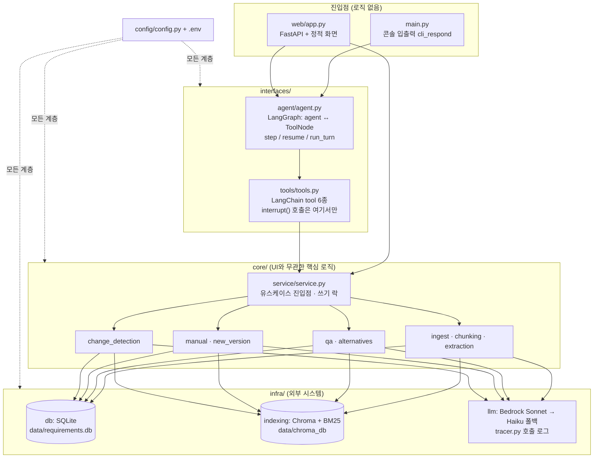
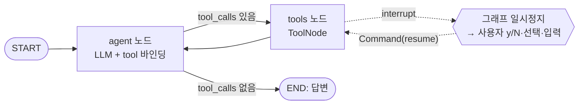
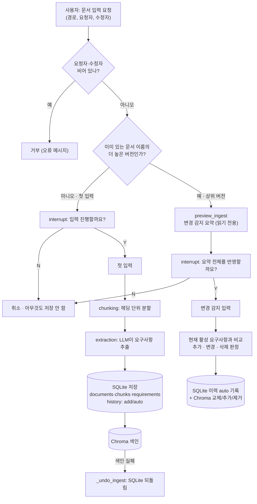
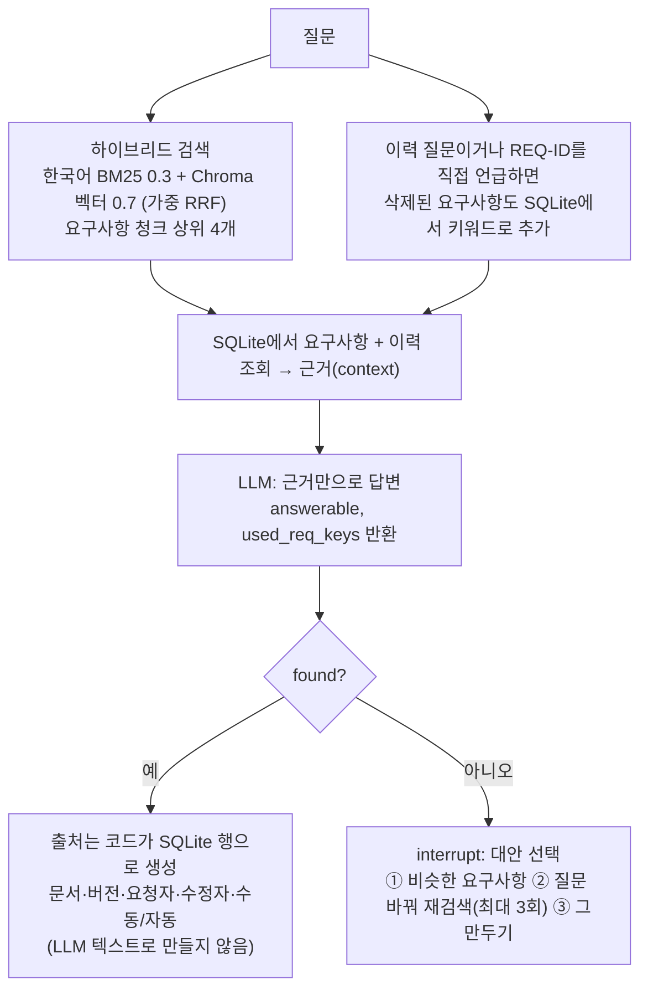
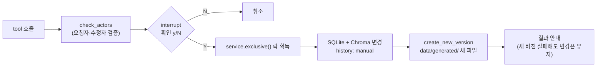
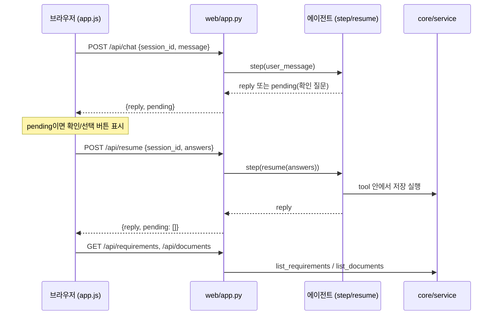
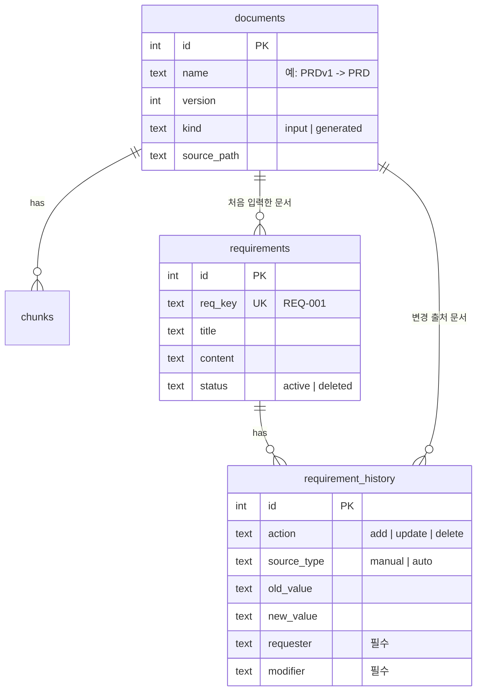

# requirement-history-agent

Markdown 요구사항 문서(PRD)에서 요구사항을 추출하고, 모든 변경을 **요청자·수정자**와 함께 이력으로 남기며, 그 이력을 근거로 **출처(문서·버전·요청자·수정자)와 함께** 질문에 답하는 대화형 에이전트입니다. 터미널과 웹 브라우저 두 가지로 쓸 수 있습니다.

> 기준 문서는 [`SERVICE.md`](SERVICE.md)(요구사항·범위·완료 기준), 작업 규칙은 [`CLAUDE.md`](CLAUDE.md), 작업 목록은 [`TASKS.md`](TASKS.md)입니다. 이 README와 충돌하면 `SERVICE.md`가 우선합니다.

## 목차

1. [무엇을 할 수 있나](#1-무엇을-할-수-있나)
2. [빠른 시작](#2-빠른-시작)
3. [사용법](#3-사용법)
4. [아키텍처와 소스 흐름](#4-아키텍처와-소스-흐름)
5. [디렉터리 구조와 파일별 설명](#5-디렉터리-구조와-파일별-설명)
6. [데이터 모델](#6-데이터-모델)
7. [웹 API](#7-웹-api)
8. [핵심 규칙](#8-핵심-규칙)
9. [테스트](#9-테스트)
10. [로그와 데이터 위치](#10-로그와-데이터-위치)
11. [자주 겪는 문제](#11-자주-겪는-문제)
12. [추가하면 좋을 내용 (제안)](#12-추가하면-좋을-내용-제안)

---

## 1. 무엇을 할 수 있나

| 기능 | 설명 |
|------|------|
| 요구사항 추출 | `.md` 문서를 헤딩 단위로 청킹하고 LLM으로 요구사항(ID·제목·내용)을 추출해 저장 |
| 이력 질의응답 | "REQ-003은 언제 바뀌었나?" 같은 질문에 이력을 근거로 답하고 출처를 코드로 붙임 |
| 수동 추가·수정·삭제 | 요청자·수정자 필수, 저장 전 y/N 확인, 이력에 `manual`로 기록 |
| 새 버전 PRD 생성 | 수동 변경을 저장할 때마다 반영된 새 Markdown 파일을 자동 생성 (원본은 수정하지 않음) |
| 변경 자동 감지 | 더 높은 버전의 문서(예: `PRDv2.md`)를 입력하면 추가·변경·삭제를 비교해 `auto` 이력으로 기록 |
| 웹 UI | 채팅, 확인 버튼, 문서 업로드, 요구사항 표·이력, 새 버전 내려받기 |
| LLM 폴백 | Sonnet이 2번 시도 후에도 실패하면 그 호출만 Haiku로 전환하고 알림 |

**하지 않는 것:** 로그인·권한, 승인 워크플로, Markdown 외 입력(엑셀·피피티·지라), 알림, 요구사항 간 의존·영향도 분석.

---

## 2. 빠른 시작

### 사전 준비

- Python 3.11 이상 권장 (코드가 `X | Y` 타입 문법을 씀)
- AWS Bedrock 접근 권한 (리전 `us-east-1`; Claude Sonnet 4.5, Haiku 4.5, Titan Embed v2 모델 사용 가능해야 함)

### 설치

```powershell
# 프로젝트 루트에서
python -m venv .venv
.venv\Scripts\Activate.ps1          # bash: source .venv/Scripts/activate
pip install -r requirements.txt
```

### AWS 인증 (`.env`)

루트에 `.env`를 만들고 자격증명을 넣습니다. `.env`는 `.gitignore`에 들어 있으며 **커밋하거나 출력하지 않습니다.**

```ini
AWS_ACCESS_KEY_ID=...
AWS_SECRET_ACCESS_KEY=...
AWS_SESSION_TOKEN=...        # 임시 자격증명을 쓸 때만
# TRACE_ENABLED=0            # LLM·도구 호출 로그를 끄려면
```

### 실행

```powershell
# 터미널 대화
python main.py

# 웹 UI (같은 네트워크의 다른 PC에서도 접속 가능) -> http://localhost:8000
python -m uvicorn --factory web.app:create_app --host 0.0.0.0 --port 8000
```

---

## 3. 사용법

모든 기능은 **자연어 대화**로 씁니다. 에이전트가 알맞은 tool을 골라 호출합니다. 기능별 CLI 명령은 없습니다.

### 3-1. 터미널 (`python main.py`)

```text
> samples/PRDv1.md 입력해줘. 요청자는 김기획, 수정자는 박개발이야.
문서 'samples/PRDv1.md'를 입력합니다 (요청자 김기획, 수정자 박개발). 진행할까요?
[y/N] y
입력 완료: PRDv1v1 (청크 ..., 요구사항 8)

> 투표 기간은 최대 며칠이야?
(출처: 문서, 버전, 요청자, 수정자와 함께 답변)

> REQ-003 내용을 "투표 기간은 최대 14일"로 수정해줘. 요청자 이기획, 수정자 박개발.
REQ-003의 내용을 ... 새 버전 문서를 만듭니다. 진행할까요?
[y/N] y
수정 완료: REQ-003
새 버전 생성: data/generated/PRDv2.md (...)

> samples/PRDv2.md 입력해줘 (요청자/수정자 ...)   # 이미 있는 문서의 상위 버전 -> 변경 감지
```

- 종료: 빈 줄, `exit`, `quit`
- **요청자·수정자를 말하지 않으면 에이전트가 먼저 되묻습니다.** 비어 있으면 저장이 거부됩니다.
- 출처를 찾지 못하면 "찾지 못했다"고 답하고 대안을 번호로 고르게 합니다: ① 비슷한 요구사항 후보 보기 ② 질문을 바꿔 다시 검색(최대 3회) ③ 그만두기
- 기본 모델 호출이 실패해 Haiku로 답하면 `※ ... 폴백 모델(Haiku)로 답했습니다.`가 표시됩니다.

### 3-2. 웹 UI

브라우저에서 `http://<서버 IP>:8000`에 접속합니다.

1. **요청자·수정자** 입력칸에 이름을 적습니다 (채팅 메시지에 자동으로 함께 전송).
2. **문서 올리기**로 `.md` 파일을 올린 뒤 채팅으로 "방금 올린 문서를 입력해줘"라고 요청합니다. (업로드 폴더 `data/uploads/`의 파일만 입력 가능)
3. 확인이 필요하면 채팅에 **확인/선택 버튼**이 나타납니다. 답하기 전에는 새 메시지를 보낼 수 없습니다(409).
4. 요구사항 표와 요구사항별 이력, 문서 목록, 생성된 새 버전 파일 내려받기를 화면에서 볼 수 있습니다.
5. 대화는 브라우저마다 세션 ID로 이어지며 새로고침·서버 재시작 후에도 유지됩니다.

> 로그인이 없으므로 **내부망 전용**으로 쓰세요. 인터넷에 직접 노출하지 마세요.

### 3-3. 에이전트가 쓰는 tool

| tool | 용도 | 저장 전 확인 |
|------|------|:---:|
| `ingest_document` | 문서 입력. 새 문서면 추출, 상위 버전이면 변경 감지 | O |
| `ask_history` | 요구사항·이력 질문 (출처 포함, 못 찾으면 대안 선택) | 대안 선택만 |
| `add_requirement` | 요구사항 수동 추가 (ID 자동 부여) | O |
| `update_requirement` | 요구사항 내용 수동 수정 | O |
| `delete_requirement` | 요구사항 수동 삭제(상태만 `deleted`로) | O |
| `create_new_version` | 새 버전 PRD를 요청해서 직접 생성 | X |

### 3-4. 새 버전 문서 형식

- 위치: `data/generated/`, 이름: `<문서명>v<최신 버전+1>.md` (기존 파일은 덮어쓰지 않음)
- 수동으로 추가·수정된 요구사항 뒤에 `- **요청자:**`, `- **수정자:**`, `- **수정일:**`이 붙고, 삭제된 요구사항은 `## 삭제된 요구사항` 섹션에 모입니다.
- 수정되지 않은 요구사항은 이전 버전과 내용이 같습니다.

---

## 4. 아키텍처와 소스 흐름

### 4-1. 3계층 구조

의존은 **한 방향**(`interfaces → core → infra`)으로만 흐릅니다. `config/`는 모든 계층이 읽고, `main.py`·`web/`은 진입점입니다.



### 4-2. 대화 한 턴의 흐름 (에이전트 그래프)



- 대화 기록은 체크포인터가 `thread_id`별로 보관합니다(콘솔: 메모리, 웹: `data/web_sessions.db`).
- `step()`이 그래프를 실행해 답변 또는 대기 중인 질문 목록(`pending`)을 돌려주고, 콘솔은 `run_turn()`이 질문마다 `respond()`를 호출해 재개하며, 웹은 `/api/resume`이 재개합니다.
- **재개하면 tool이 처음부터 다시 실행**되므로, `interrupt()` 앞에는 검증·조회처럼 부작용 없는 코드만 두고 저장은 확인 뒤에 합니다.

### 4-3. 문서 입력 흐름 (`ingest_document`)



### 4-4. 질의응답 흐름 (`ask_history`)



핵심: **출처는 LLM이 쓰지 않고 코드가 DB 행으로 만듭니다.** LLM은 어떤 요구사항 ID를 근거로 썼는지만 알려 줍니다.

### 4-5. 수동 변경 흐름 (`add/update/delete_requirement`)



락을 쥔 채로 변경과 새 버전 생성을 한 덩어리로 실행하므로, 여러 명이 동시에 저장해도 저장마다 번호가 다른 새 파일이 만들어집니다.

### 4-6. 웹 요청 흐름



---

## 5. 디렉터리 구조와 파일별 설명

```text
requirement-history-agent/
├── main.py                      # 콘솔 진입점: 대화 루프, cli_respond (입출력만)
├── config/config.py             # 모델 ID, 리전, Chroma 경로, 로그 설정 (.env 로드)
├── interfaces/
│   ├── agent/agent.py           # LangGraph 그래프, run_config / step / resume / run_turn
│   └── tools/tools.py           # tool 6종, interrupt() 확인, 입력 폴더 제한
├── core/
│   ├── service/service.py       # 유스케이스 진입점, 쓰기 락, 조회용 함수(list_*)
│   ├── ingest/ingest.py         # 문서 파싱, 첫 입력(SQLite 저장), 문서명·버전 해석
│   ├── chunking/chunking.py     # Markdown 헤딩 단위 청킹
│   ├── extraction/extraction.py # LLM으로 요구사항 추출, 새 버전 문서의 변경 정보 분리
│   ├── qa/qa.py                 # 검색 → 근거 조립 → LLM 답변 → 출처 생성
│   ├── qa/alternatives.py       # 출처 없을 때 대안(비슷한 요구사항 후보)
│   ├── manual/manual.py         # 수동 추가·수정·삭제
│   ├── manual/new_version.py    # 새 버전 PRD 생성
│   └── change_detection/        # 상위 버전 문서 vs 현재 요구사항 비교 (detection.py, changes.py)
├── infra/
│   ├── db/db.py                 # SQLite 스키마·연결
│   ├── db/validation.py         # require_actors: 요청자·수정자 필수 검증
│   ├── indexing/indexing.py     # Chroma 색인, 한국어 BM25 + 벡터 하이브리드 검색
│   └── llm/llm.py, tracer.py    # Bedrock LLM/임베딩, Haiku 폴백, JSONL 호출 로그
├── web/
│   ├── app.py                   # FastAPI (create_app 팩토리)
│   └── static/                  # index.html, app.js, style.css
├── samples/                     # PRDv1.md, PRDv2.md, LargePRDv1.md (정기투표앱 가상 PRD)
├── tests/                       # pytest (일부는 실제 Bedrock 호출)
├── evals/                       # 정답셋 평가 (eval_set.json, run_eval.py, 결과·이력)
├── data/                        # 실행 시 생성 (DB, Chroma, 업로드, 생성 문서, 로그) — git 제외
├── practices/day*_practice/     # 참고용 기존 자료 (수정·사용 금지)
├── SERVICE.md  CLAUDE.md  TASKS.md
└── requirements.txt
```

---

## 6. 데이터 모델

SQLite(`data/requirements.db`)가 원본(source of truth), Chroma(`requirements_history` 컬렉션)는 의미 검색용 색인입니다.



- `requirement_history`의 `requester`/`modifier`에는 DB `CHECK (length(trim(...)) > 0)`가 걸려 있어 **코드 검증을 우회해도 빈 값은 저장되지 않습니다.**
- 삭제는 행을 지우지 않고 `status='deleted'`로 표시하며, 삭제된 ID는 다시 쓰지 않습니다.
- 문서 이름은 `PRDv1.md` → 이름 `PRD`, 버전 `1`로 해석합니다 (`v숫자` 접미사가 없으면 버전 1).

---

## 7. 웹 API

요청·응답 형식, 오류 코드, 확인 대기(`pending`) 질문의 구조 등 자세한 명세는 [API.md](API.md)를 보세요.

| 메서드·경로 | 설명 |
|-------------|------|
| `POST /api/chat` | `{session_id, message}` → `{reply, pending}`. 확인 대기 중이면 409 |
| `POST /api/resume` | `{session_id, answers}` → 대기 중인 모든 질문에 한 번에 답해 재개 |
| `GET /api/session/{id}` | 대화 내역과 대기 중인 질문 복원 |
| `POST /api/upload` | `.md`(UTF-8, 최대 1MB)를 `data/uploads/`에 저장 |
| `GET /api/documents` | 입력 문서와 생성된 새 버전 문서 목록 |
| `GET /api/files/{document_id}` | 시스템이 만든 새 버전 파일만 내려받기 |
| `GET /api/requirements` | 요구사항 목록(활성 먼저, 삭제 포함) |
| `GET /api/requirements/{REQ-ID}/history` | 요구사항별 이력 |

`session_id`는 `[A-Za-z0-9_-]{8,64}` 형식입니다. 오류는 스택 트레이스 없이 `{"error": ...}`로 돌려줍니다.

---

## 8. 핵심 규칙

1. **요청자·수정자 필수** — 어떤 경로(수동 변경, 문서 입력, 변경 감지)로도 비면 저장 거부. 코드(`require_actors`)와 DB 제약 양쪽에서 막음.
2. **수동/자동 구분** — 이력에 `manual` / `auto` 기록. 문서 입력·변경 감지는 `auto`, 사람이 직접 추가·수정·삭제하면 `manual`.
3. **출처를 지어내지 않음** — 못 찾으면 "찾지 못했다"고 답하고 대안 선택을 안내.
4. **정확성 우선** — 응답 속도는 요구사항이 아님.
5. **UI와 핵심 로직 분리** — `main.py`·`web/`·`agent`·`tools`에는 로직을 두지 않고 `core/service`를 호출만 함.
6. **사용자 확인은 모두 `interrupt()`** — `interfaces/tools/tools.py`에서만 호출, 재개는 `run_turn`/`step`이 담당.
7. **원본 입력 문서는 수정하지 않음**, `practices/`는 건드리지 않음, 자격증명은 `.env`로만.

---

## 9. 테스트

```powershell
python -m pytest -q                       # 전체 (실제 Bedrock 호출 포함, 비용 발생)
python -m pytest -q tests/test_db.py      # 개별 실행
```

| 완료 기준 | 명령 |
|-----------|------|
| 1. 문서 입력·추출 | `python -m pytest -q tests/test_ingest.py` |
| 2. 수동 변경 + 이력 표시 | `python -m pytest -q tests/test_manual_crud.py` |
| 3. 요청자·수정자 필수 | `python -m pytest -q tests/test_required_actors.py` |
| 4. 이력 질문 10개 정확도 | `python -m pytest -q tests/test_history_qa.py` |
| 5. 출처 없음 안내 | `python -m pytest -q tests/test_not_found.py` |
| 6. 요구사항 100개 규모 | `python -m pytest -q tests/test_scale.py` |
| 7. 새 버전 PRD 생성 | `python -m pytest -q tests/test_new_version.py` |
| 2차: 변경 감지 | `python -m pytest -q tests/test_change_detection.py tests/test_change_flow.py` |
| 2차: 변경 이력 질문 | `python -m pytest -q tests/test_change_history_qa.py` |
| 2차: 웹 | `python -m pytest -q tests/test_web_api.py tests/test_web_concurrency.py` |

Bedrock을 실제로 호출하는 테스트는 비용과 외부 전송이 생기므로 호출 횟수를 최소화해 실행하세요. 테스트에서는 trace 로그가 항상 꺼집니다.

### 정답셋 평가 (매 개발 사이클)

`evals/`는 pytest와 별개로, 질문 세트에 기대값을 붙여 매 사이클 정확도를 추적하는 도구입니다.

```powershell
python evals/run_eval.py                  # 22문항 전체 (실제 Bedrock 호출)
python evals/run_eval.py --only hist      # id가 hist로 시작하는 문항만 (기록은 남기지 않음)
python evals/run_eval.py --judge          # + LLM 심사자가 답변 문장을 평가 (문항당 Bedrock 호출 1회 추가)
python evals/run_eval.py --ragas          # + RAGAS faithfulness·answer_relevancy 점수 (문항당 Bedrock 호출 여러 번)
```

| 파일 | 내용 |
|------|------|
| `evals/eval_set.json` | 문항 22개: `fact` 10(PRDv1), `history` 10(변경 이력), `no_answer` 2. 문항마다 `expected`(`found`, `keywords`, `source`)를 적음. 문항을 추가하려면 이 파일만 고치면 됨 |
| `evals/eval_result.json` | 마지막 실행의 문항별 결과(통과 여부, 사유, 답변, 폴백 사용 여부) |
| `evals/eval_history.jsonl` | 실행마다 한 줄(시각, 커밋, 통과 수, 유형별 결과, 틀린 문항, 폴백 수). 직전 실행과 비교해 회귀를 알려 줌 |

- `source`에 적은 항목(`req_key`, `action`, `source_type`, `requester`, `modifier`, `document`, `version`)을 모두 만족하는 출처가 하나 있어야 통과합니다.
- 임시 DB·Chroma를 쓰므로 `data/`는 건드리지 않습니다. 틀린 문항이 있으면 종료 코드 1을 돌려줍니다.
- `--judge`(LLM-as-judge, `evals/judge.py`): 답을 찾은 답변마다 근거(출처가 가리키는 요구사항과 이력)를 보여 주고 `supported`(내용이 모두 근거로 뒷받침됨)와 `answers_question`(질문에 답함)을 판정합니다. 출처는 코드가 정확히 대조하므로 심사하지 않고, 결과는 참고용이라 통과 여부·종료 코드에 영향이 없습니다. "확인 필요"로 표시된 문항은 사람이 읽어 보세요. 결과는 `eval_result.json`의 `llm_judge`와 `eval_history.jsonl`의 `judge`·`judge_flagged`에 남습니다.
- `--ragas`(`evals/ragas_metrics.py`): 답을 찾은 답변마다 `faithfulness`(답변이 근거로 뒷받침되는 비율)와 `answer_relevancy`(질문과의 관련도)를 0~1로 산출하고 요약에 평균과 0.7 미만 문항을 보여 줍니다. 근거는 `--judge`와 같이 출처가 가리키는 요구사항과 이력입니다. 참고용이라 통과 여부·종료 코드에 영향이 없고, `answer_relevancy`는 짧고 정확한 답에도 낮게 나올 수 있어 추세와 이상치를 보는 용도입니다. Context Precision/Recall은 기준 답변이 없어 아직 없습니다. 패키지 `ragas`가 필요합니다(`pip install -r requirements.txt`).
- Sonnet 호출이 실패해 Haiku로 답한 문항은 `(폴백)`으로 표시되고 요약에 건수가 나옵니다.

---

## 10. 로그와 데이터 위치

| 경로 | 내용 |
|------|------|
| `data/requirements.db` | 문서·청크·요구사항·이력 (SQLite) |
| `data/chroma_db/` | 임베딩 색인 (Chroma, 컬렉션 `requirements_history`) |
| `data/generated/` | 시스템이 만든 새 버전 PRD |
| `data/uploads/` | 웹에서 올린 문서 |
| `data/web_sessions.db` | 웹 대화 체크포인트 |
| `data/logs/llm_trace.jsonl` | LLM·도구 호출 로그 (모델, 프롬프트, 토큰, 소요 시간, 오류) |

- 에이전트를 부르는 곳은 반드시 `run_config(thread_id)`로 설정을 만들어야 로그가 남습니다.
- 로그와 DB에는 **요구사항 내용이 들어 있으므로** `data/` 밖으로 옮기거나 커밋하지 마세요. 긴 글은 1,000자에서 잘립니다.
- 초기화하려면 서버·콘솔을 끄고 `data/`를 지웁니다 (DB와 Chroma는 **같이** 지워야 어긋나지 않습니다).

---

## 11. 자주 겪는 문제

| 증상 | 원인·해결 |
|------|-----------|
| `DB가 없습니다. 먼저 ingest로 문서를 입력하세요.` | 아직 문서를 입력하지 않았음. 먼저 문서 입력 |
| `이미 입력된 문서입니다` | 같은 이름·버전은 다시 입력 불가. 파일명의 버전을 올릴 것 (`PRDv2.md`) |
| `시스템이 ... 만든 문서라 같은 버전으로 입력할 수 없습니다` | 생성된 새 버전과 같은 번호. 버전을 올려 입력 |
| `v...에는 바뀐 요구사항이 없어 저장하지 않았습니다` | 상위 버전이지만 현재 요구사항과 차이가 없음 (정상) |
| `허용된 폴더(업로드한 문서)의 파일만 입력할 수 있습니다` | 웹에서는 업로드 폴더의 파일만 입력 가능. 화면의 업로드 사용 |
| 웹에서 409 `먼저 확인 요청에 답해 주세요` | 대기 중인 확인 버튼에 먼저 답할 것 |
| Bedrock 인증·접근 오류 | `.env` 자격증명, 리전(`us-east-1`), 모델 접근 권한 확인 |
| 한국어 BM25 관련 import 오류 | `pip install -r requirements.txt`로 `kiwipiepy`, `rank-bm25` 설치 확인 |

---

## 12. 추가하면 좋을 내용 (제안)

> 아래는 **현재 범위 밖이거나 아직 없는 항목에 대한 제안**입니다. `CLAUDE.md` 규칙상 범위 밖 기능은 요청 없이 구현하지 않으므로, 필요하다고 판단되면 먼저 알려 주세요.

### 문서·운영

- **`.env.example` 추가:** 필요한 키 이름만 담은 샘플 파일(값 없음)로 온보딩 단축.
- **데이터 백업·초기화 절차:** SQLite와 Chroma를 항상 함께 백업·복원하는 방법, `data/` 초기화 스크립트.
- **실제 화면 스크린샷·데모 GIF:** 웹 UI 사용법 섹션에 첨부.
- **`CONTRIBUTING`/개발 가이드:** 계층 의존 규칙(`interfaces → core → infra`) 위반을 잡는 체크 방법.

### 품질·안정성 (범위 안에서 가능한 개선)

- **계층 의존 검사 테스트:** `core`가 `interfaces`를 import하지 않는지 자동 확인하는 pytest(`import-linter` 등은 새 패키지라 먼저 확인 필요).
- **CI 구성:** Bedrock이 필요 없는 테스트(`test_db`, `test_chunking`, `test_required_actors` 등)만 PR마다 실행하고, Bedrock 테스트는 수동 또는 야간 실행으로 분리.
- **pytest 마커 도입:** `@pytest.mark.bedrock`으로 비용이 드는 테스트를 `-m "not bedrock"`로 쉽게 제외.
- **`requirements.txt` 버전 고정:** 일부만 고정(`mcp`, `fastmcp`)되어 있어 재현성이 낮음. `pip freeze` 기반 잠금 파일 검토.
- **Haiku 폴백 정확도 측정:** 현재 질문 세트는 Sonnet 기준이며 Haiku로는 따로 측정하지 않음(SERVICE.md T14).
- **Python 버전 명시:** `pyproject.toml` 또는 문서에 지원 버전 기재.

### 기능 (범위 확장이라 별도 합의 필요)

- **이력 내보내기:** 요구사항별 이력을 CSV/Markdown으로 내려받기 (감사·보고용).
- **요구사항 검색·필터 UI:** 상태, 수정자, 기간별 필터.
- **버전 간 diff 보기:** 두 문서 버전 사이의 추가·변경·삭제를 화면에서 비교.
- **감지 요약의 항목별 선택:** 현재는 요약 전체에 y/N 한 번(SERVICE.md T26). 항목별 반영이 필요하면 확장.
- **다중 프로세스 쓰기 안전성:** 지금의 쓰기 락은 **한 프로세스 안**에서만 유효. 서버를 여러 워커로 띄우려면 DB 수준 락이나 단일 워커 고정이 필요(현재는 단일 프로세스 가정).
- **로그 보관 정책:** `llm_trace.jsonl` 로테이션·보관 기간 (요구사항 내용이 포함되므로 보안상 중요).

### 보안 (내부망 전용 전제)

- 로그인이 없으므로 요청자·수정자는 **자기 신고 값**입니다. 신뢰 경계를 문서에 명시하고, 필요해지면 리버스 프록시 인증이나 접근 IP 제한을 검토하세요. (로그인·권한 자체는 현재 범위 밖)
